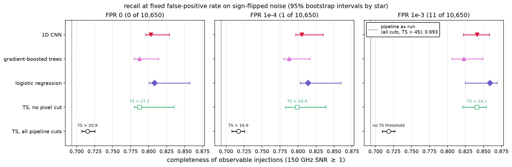
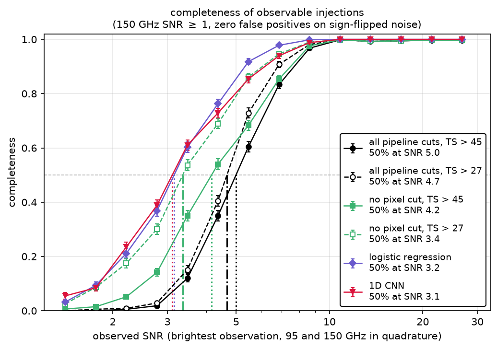

# flare_classifier

Can machine learning find faint stellar flares in South Pole Telescope (SPT-3G) light curves better than the pipeline's TS > 45 cut, at the same false-positive rate?

Everything here uses public data ([Tandoi et al. 2024](https://arxiv.org/abs/2401.13525)), so the whole analysis can be rerun end to end.

## Results
Completeness on 10,833 injected flares (observable: 150 GHz SNR $\geq$ 1) at zero false positives on 10,650 sign-flipped noise windows. Intervals are 95% bootstrap by star.

| method | completeness |
|---|---|
| pipeline as run (all cuts, TS > 45) | 0.693 |
| TS, all pipeline cuts, threshold re-tuned | 0.715 |
| TS, no pixel significance cut | 0.787 |
| logistic regression (8 window features) | **0.808** [0.801, 0.857] |
| gradient-boosted trees | 0.787 |
| 1D CNN (PyTorch, 5-seed ensemble) | 0.803 [0.796, 0.829] |


*Recall of observable injections at fixed false-positive rates on sign-flipped noise (95% bootstrap intervals by star). TS rows are re-tuned at each rate, the dotted line is the pipeline as run (TS > 45, all cuts).*

- **Most of the gain is removing one cut, not ML** 
   
   Removing the pipeline's pixel significance cut (3-$\sigma$ in both bands in one observation) recovers +0.07. Logistic regression adds a small but consistent +0.013 [+0.009, +0.032] on top (paired bootstrap).

- **The pixel cut is spectrally selective**

   At fixed total significance, near-threshold completeness drops from 0.12 at $\alpha = 0$ to 0.01 at $\alpha = 3$. TS without the cut, and logistic regression, are flat in $\alpha$.

- **The flexible models learned the wrong things**

   Gradient-boosted trees learned the training set's spectral index distribution: near threshold, they detect 38% of falling-spectrum flares vs 90% of rising ones. The CNN matches logistic regression overall, but its completeness is up to 0.23 lower for short (< 1 h), moderately bright flares. Its noise tail is single-observation spikes, so it has to reject flares that look like them.

- **Real flares**

   logistic regression recovers 110 of the 111 catalog events, the same as TS, plus one flare that TS misses ([Guns, Tandoi et al. 2026](https://arxiv.org/abs/2610.28633)). The one miss has its detection observation missing from the public light curve.


*Completeness vs observed SNR (brightest observation, 95 and 150 GHz combined) at zero false positives on sign-flipped noise. The pixel significance cut sets the pipeline's floor near SNR 4–5; without it TS reaches 50% at 3.4, logistic regression at 3.2 and the CNN at 3.1. The CNN is competitive with logistic regression up to about 60% completeness.*

## Method

1. **Validate the baseline** 

   Refit every catalog event with a two-band Gaussian TS fitter ([TS_fitter](https://github.com/christandoi/TS_fitter)) on the public light curves: median refit/published TS is 0.992 (110/111 events).

2. **Build the dataset** 

   Use 12-day windows with a 6-day stride. Negatives are windows away from known flares. Positives are 20,000 Gaussian flares injected into real noise: FWHM 30 min–10 d, spectral index drawn from the catalog. Every window is fit and summarized by a handful of features (TS, FWHM, amplitude SNRs, fit quality, peak SNR, ...).

3. **Train with star-grouped 5-fold cross-validation** 

   Every window is scored by a model that never saw its star (66 stars; 17 of them hold 62 of the 111 catalog flares).

4. **Measure false positives on sign-flipped noise** 

   Raw negatives contain real, uncataloged flares: there are 17 two-band 3-$\sigma$ positive outliers where 0.2 are expected, against 1 negative. Flipping the sign keeps the noise and turns the hidden flares into dips the detectors ignore.

5. **Data layer** 

   A PostgreSQL database (in a container) holds light curves, catalog, windows, fits and injections. Windows, contamination flags and the training set are built in SQL and match the Python version row for row. The CNN reads its input sequences from the database.

## Run it

Requires Python 3 and Podman or Docker

```bash
python -m venv .venv && source .venv/bin/activate
pip install -r requirements.txt
pip install torch==2.14.1 --index-url https://download.pytorch.org/whl/cpu
```

1. Download into `data/`:
   - `spt3g_flare_lightcurves_2019_2022.fits` from [Zenodo 10.5281/zenodo.11372033](https://doi.org/10.5281/zenodo.11372033)
   - `spt3g_2019_2022_flare_star_catalog.csv` from [pole.uchicago.edu/public/data/tandoi24](https://pole.uchicago.edu/public/data/tandoi24/)
2. Run `01_feature_models.ipynb` up to the SQL check. The slow fits are cached in `data/` after the first run.
3. Start and load the database:
   ```bash
   podman-compose up -d # or: docker compose up -d
   podman exec -i flare_db psql -U flare -d flares < sql/schema.sql
   python load_db.py
   ```
4. Finish 01 (the SQL check), then run `02_cnn_model.ipynb`. CNN training should take <5 minutes on CPU.

## Repository

| file | contents |
|---|---|
| `01_feature_models.ipynb` | validation, dataset, injections, logistic regression and gradient-boosted trees, evaluation |
| `02_cnn_model.ipynb` | 1D CNN: sequences from Postgres, training, the same evaluation |
| `TS_fitter.py`, `fitter_validation.py` | TS fitter and catalog validation |
| `read_spt3g_fits.py`, `dataset.py` | light-curve reading, windows, injections, features |
| `evaluation.py` | thresholds, recall at fixed FPR, bootstrap, binned completeness |
| `sequences.py`, `cnn.py` | CNN inputs and model |
| `compose.yaml`, `sql/`, `load_db.py` | database |
| `plotting_functions.py` | shared plot styles |

## Notes on this project

- **Injection shape:** 

   injections are symmetric Gaussians, the same shape TS assumes, so they're TS's best case. Real flares (stellar flares: fast rise, slow decay, multiple peaks) would likely favor the learned models. All completeness numbers are for this injected population.

- **False-positive floor:** 

   10,650 noise windows measure FPR only down to about 1e-4. The pipeline searches far more windows than that and needs a lower FPR, so these results don't show that TS > 45 is too strict.

- **Population:** 

   the data covers only the 66 public flare stars. Testing on random-sky light curves would need data that isn't public.

- **Results:**

   this measures recovery of injected flares; it doesn’t search for new below-threshold flares or vet real candidates, which needs full TS maps (see the TS_fitter repo) and private data. It’s also tuned to the short-duration flares of Tandoi 2024: long-duration transients such as AGN would need different injections and training.


## Figures

All in `images/`:
- `evaluation/recall_summary.png`: recall at FPR 0, 1e-4, 1e-3 with bootstrap intervals
- `evaluation/completeness_vs_snr.png`: completeness vs observed SNR
- `evaluation/completeness_maps.png`: completeness over SNR and FWHM, pipeline vs logistic regression
- `evaluation/fixed_alpha.png`: completeness vs spectral index at fixed significance
- `evaluation/spectral_bias.png`: near-threshold completeness by spectral index (gradient-boosted trees bias)
- `evaluation/disagreement.png`: where the methods disagree, by SNR, FWHM and spectral index
- `evaluation/interband_sign_test.png`: two-band outliers vs Gaussian noise (why sign-flipped noise)
- `evaluation/top_negatives.png`: highest-scoring "noise" windows, several of which look like real flares
- `validation/ts_validation.png`: refit vs published TS

## License

MIT (see `LICENSE`).